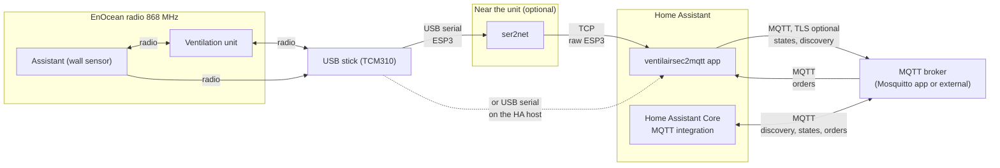
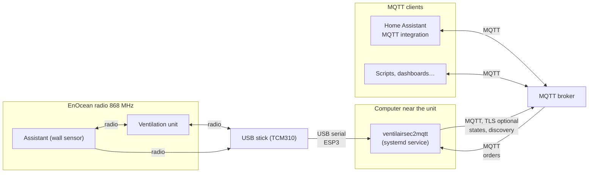

# Architecture

Phase 1 is the protocol core: framing, decoding, orders and the link to the EnOcean stick. It
has no MQTT and no Home Assistant code. Phase 2 is the MQTT bridge (`src/bridge/`, entry point
`src/main.ts`), built on the phase 1 API. Radio facts refer to [protocol.md](protocol.md), MQTT
topics and entities to [mqtt-interface.md](mqtt-interface.md).

## Deployment

The same program runs in two ways:

- **Home Assistant app**: the simplest for users. The stick is plugged into the Home Assistant
  host, or into a computer near the unit that shares it over the network with ser2net.
- **Standalone service**: the program runs on the computer the stick is plugged into (for example
  a Raspberry Pi near the unit, under systemd). Only MQTT crosses the network; Home Assistant and
  any other client just use the broker.

In both cases the MQTT interface is the same ([mqtt-interface.md](mqtt-interface.md)).

### Home Assistant app



### Standalone service



| Link | Protocol | Tool |
|---|---|---|
| Unit, Assistant, stick | EnOcean radio 868 MHz, ERP1 telegrams, MSC D1-079 profile | unit firmware, TCM310 module |
| Stick → computer | USB serial 57,600 baud 8N1, ESP3 packets | USB serial driver |
| Remote stick → app (app mode) | TCP, the same ESP3 bytes | ser2net |
| Program ⇄ broker | MQTT (optionally TLS) | mqtt.js |
| Home Assistant and other clients ⇄ broker | MQTT | Home Assistant MQTT integration, any MQTT client |

The standalone service needs Node.js 20 or later (the version packaged for ARMv6 boards such as
the Raspberry Pi Zero) and an explicit broker (`mqtt_host`), since there is no Supervisor.

## Layers

```text
StickConnection   supervision: reconnect, silence, fallback port, Base ID       connection.ts
  └─ Stick        ESP3 session: request/response queue, RX dispatch            stick.ts
       ├─ Transport          TCP (socket://host:port) or serial (57600 8N1)    transport/
       ├─ Esp3Decoder        framing, CRC8, resynchronisation                  esp3/
       └─ ChainReassembler   RORG 40 pieces → one telegram                     chain.ts
classifyTelegram  who sent what to whom → decoded frame                        classify.ts
  ├─ decodeUnitStatus        unit CMD 0–8 (D1-079-01)                          msc/unit.ts
  └─ decodeAssistant         Assistant CMD 1/3 (D1-079-00)                     msc/assistant.ts
orders / pairing  telegrams to transmit, teach-in policy                       orders.ts, pairing.ts
```

Everything below `Stick` is pure (bytes in, values out) and tested without I/O. Side effects
(sockets, serial ports, timers) are confined to `transport/`, `stick.ts` and `connection.ts`;
timers and the clock are injected through the `Timers` interface, the logger through `Logger`
(no-op by default; raw RX/TX frames are logged at debug level).

## Modules

| Module | Role |
|---|---|
| `hex.ts` | Hex conversion; EnOcean IDs as 8-character upper-case strings (`EnOceanId`). |
| `esp3/crc8.ts`, `esp3/packet.ts` | CRC8 (poly `07`); `encodePacket`; `Esp3Decoder` fed with arbitrary chunks: drops garbage, resynchronises on a bad header CRC, skips a bad data CRC, bounds the announced length. |
| `esp3/commands.ts` | `CO_RD_IDBASE` (with remaining writes), `CO_WR_IDBASE` (range and alignment checked), `CO_WR_RESET`; RESPONSE return codes and EVENT codes. |
| `erp1.ts` | `parseErp1` (sub-telegrams, destination, dBm as a negative number, security level); `buildErp1Packet` (optional `03 | destination | FF | 00`). |
| `chain.ts` | `ChainReassembler`: key sender + destination + SEQ, SEQ bits 7-6 / IDX 5-0, 16-bit length, timeout (5 s), cap (16), sender allow-list, pieces in any order. |
| `msc/bits.ts`, `msc/envelope.ts` | Bit fields counted from the MSB of the MSC payload; a field beyond the payload is `undefined`, never 0. |
| `msc/assistant.ts` | Assistant commands 1 and 3 (raw battery 0–6, temperature, humidity); other commands kept raw. |
| `msc/unit.ts`, `msc/function-byte.ts`, `msc/errors.ts` | Unit commands 0–8, function byte bits, error code labels. |
| `classify.ts` | Tells unit status, unit → Assistant frames, Assistant frames and teach-in queries apart. |
| `machine-id.ts` | `MachineIdGuard`: flags a status frame carrying another machine ID. |
| `orders.ts` | `CMD 0` settings (ranks, `FF` = unchanged, validation), `CMD 1` clock, transmit telegram (status `80`, broadcast). |
| `pairing.ts` | UTE query detection, response telegram, `shouldAnswerTeachIn` policy. |
| `transport/` | `parseConnectionUrl`, `createTransport`, `TcpTransport`, `SerialTransport` (injectable port factory). |
| `stick.ts` | `Stick`: one command at a time, first command repeated once without answer, Base ID read/write, `send` with confirmation, `telegram` / `event` / `incident` events. |
| `connection.ts` | `StickConnection`: the object phase 2 holds. |

## Decoded values

- `undefined`: the field is absent from the frame (short frame) or its raw value is unknown;
  the matching `…Raw` field keeps the byte.
- `null`: the frame explicitly says disabled / no probe / not applicable (preheating `4`,
  Hydro'R `6` or `0`, SolarR `0`, probe position `255`, bypass opening or position `255`).
- Enumerations are lower-case strings: modes `standby|eco|standard|comfort`, seasons
  `summer|winter|mid_season`, system states `boost|holiday|standby|fixed_airflow|normal`, probe
  positions `supply|intake|water_loop|solar|bypass`, bypass positions, rooms, sensor profiles.
- Values whose meaning is uncertain stay raw: Assistant battery, pressure setpoint,
  consumption, operating time (days), localisation bit, event type.

## API for phase 2

```ts
import {
  StickConnection, classifyTelegram, MachineIdGuard, buildSettingsTelegram,
  updateFunctionByte, buildClockTelegram, buildTeachInResponse, shouldAnswerTeachIn,
} from './index.ts';

const link = new StickConnection({ primary: 'socket://bridge.example:3333', fallback: '/dev/ttyUSB0', logger });
link.on('connected', ({ port, baseId }) => { /* sender ID = option or baseId */ });
link.on('disconnected', ({ reason }) => { /* closed | silence | switching | stopped */ });
link.on('portSwitched', ({ from, to, reason }) => { /* primary_failures | primary_available */ });
link.on('incident', ({ reason }) => { /* transmission_not_confirmed | no_answer */ });
link.on('telegram', (telegram) => {
  const c = classifyTelegram(telegram, { unitId, assistantId, receiverIds: [senderId] });
  // c.kind: unit_status | unit_to_assistant | unit_to_other | assistant | teach_in_query | ignored
});
link.start();

const fn = updateFunctionByte(lastCmd0.functionByte, { fixedAirflow: true });
const result = await link.send(buildSettingsTelegram({ functionByte: fn, oneShot: 'refresh' }, senderId));
// result.confirmed, or result.reason: rejected | no_answer | not_connected
```

- **Orders**: one `SettingsOrder` per frame (`mergeSettings` combines several keys); invalid
  values throw `OrderError` with the field name. `updateFunctionByte` needs the last `CMD 0`
  function byte received.
- **Pairing**: on `teach_in_query`, call `shouldAnswerTeachIn(now, { lastAnswerAt,
  lastAddressedToUsAt }, { enabled })`, then send `buildTeachInResponse(telegram, senderId)`.
  The bridge records both timestamps.
- **Machine ID**: feed `CMD 3` machine IDs to a `MachineIdGuard`; on `mismatch`, raise a
  `machine_id_mismatch` incident.
- **Assistant ID**: when not configured, it can be learnt from the unit's `CMD 8` frames
  (profile `assistant`) or from the sender of frames addressed to the unit.
- **Base ID**: `forceBaseId` is an explicit opt-in; the write is attempted at most once per
  `StickConnection` and logged as a warning.

## Phase 2: MQTT bridge

```text
main.ts           CLI (--help, --version), options, logging, signals           main.ts, bridge/cli.ts
  └─ startApp     composition: state file, broker, StickConnection, mqtt.js    bridge/app.ts
       └─ Bridge  link events → models → MQTT; MQTT orders → telegrams         bridge/bridge.ts
            ├─ UnitModel / AssistantModel   JSON states                        bridge/*-model.ts
            ├─ discovery + entity catalog   device-based discovery payloads    bridge/discovery.ts, entities.ts, names.ts
            ├─ order parsing                validation, never clamped          bridge/commands.ts
            └─ trackers                     availability, stick problem        bridge/watchdog.ts
```

`Bridge` owns no connection: it listens to a `BridgeLink` (the `StickConnection` events
`connected`, `disconnected`, `portSwitched`, `incident`, `telegram`, and `send`) and publishes
through a `MqttPublisher` (`connected`, `publish`). The caller subscribes to
`bridge.subscriptions()`, forwards messages to `bridge.handleMessage()` and calls
`bridge.onMqttConnected()` after each broker (re)connection. Timers, clock and logger are
injected, so every behaviour is tested with manual timers and doubles.

| Module | Role |
|---|---|
| `bridge/config.ts` | Options file (`/data/options.json` by default): strings trimmed, empty = unset, types, ranges, ID formats and Base ID constraints checked; every problem listed in one `ConfigError`; unknown keys are warnings. |
| `bridge/supervisor.ts` | `resolveBroker`: external broker when `mqtt_host` is set, else `GET http://supervisor/services/mqtt` with `SUPERVISOR_TOKEN` (`BrokerConfigError` on missing token, unreachable Supervisor or no service). |
| `bridge/state-store.ts` | `/data/state.json` by default: `boost_duration`, `holiday_duration`, learned `assistant_id`. Missing or corrupt file → defaults (logged); writes go to a temp file renamed over the real one, one at a time. |
| `bridge/unit-model.ts` | Unit JSON state from `CMD 0`–`8`: absent field → last value kept; raw value outside the known table or disabled setpoint → `null`; derived values (`filter_days_left`, `problem` with `error_codes` / `error_labels`, `self_test` with `self_test_results`, `paired_sensors`, probes by position, `last_seen`, `signal_strength`); optional equipment (`features`) and device card facts. |
| `bridge/assistant-model.ts` | Assistant JSON state; battery = round(raw × 100 / 6), raw kept in `battery_raw`. |
| `bridge/entities.ts`, `bridge/names.ts` | Entity catalog (platform, category, class, unit, options, ranges, attributes, required equipment) and entity names (English only). |
| `bridge/discovery.ts` | One retained message per device on `<discovery_prefix>/device/<prefix>_<id>/config`: `dev`, `o` (name, version, `homepage` of package.json), shared `state_topic`, `availability` (bridge + device, `availability_mode: all`), `qos`, `cmps`. Value templates read the device JSON (`value_json.get(...)`, so a missing key renders `None` = unknown). |
| `bridge/commands.ts` | Order parsing for `<prefix>/<vmi_id>/set` (JSON) and `…/set/<key>` (raw): booleans `true`/`false`/`ON`/`OFF`, integers as numbers or strings (`"25.0"` accepted), setpoints `off` or °C; invalid or unknown keys reject the whole order. |
| `bridge/watchdog.ts` | `AvailabilityTracker` (offline 30 min after the last frame, armed at start) and `IncidentTracker` (stick problem cleared 30 min after the last incident). |
| `bridge/bridge.ts` | The behaviour below. |
| `bridge/app.ts` | `startApp`: loads the state file, resolves the broker, creates the `StickConnection` and the mqtt.js client (last will `offline` on `<prefix>/bridge/state`, QoS 1, retained states), wires them to a `Bridge`; `stop()` publishes `offline`, closes the stick and the client. |
| `bridge/scan.ts` | Scan mode (empty `vmi_id`): `ScanBridge` publishes only the bridge device and state, transmits nothing; `DeviceScanner` guesses each Ventilairsec sender's role (unit reporting to us or to another receiver, Assistant, pairing request, paired sensor list, or "probably" from the frame shape and its peer) and logs each finding once. |
| `bridge/log.ts` | Lines on stdout at `log_level` (`debug`, `info`, `warning`, `error`); raw frames at debug. Formats: `<ISO time> <LEVEL> <message>` by default, `<LEVEL> <message>` with `--no-timestamps`, and `<priority><LEVEL> <message>` (sd-daemon prefix, no timestamp) when stdout is the systemd journal (`JOURNAL_STREAM` matching stdout). |

### Behaviour choices

- **Sender ID**: `sender_id` option, else the Base ID read at each connection; a warning when the
  option lies outside Base ID + 0…127. Unit status is decoded only from frames addressed to it
  (`classifyTelegram` with `receiverIds`); frames from the unit to anyone else only refresh the
  unit's availability.
- **Unit discovery** is published once `CMD 4`, `5`, `6` and `7` have each been received (the
  entity set depends on them), then again whenever the payload changes. A component that
  disappears is first published as `{"p": "<platform>"}` (removal, as the Home Assistant
  documentation describes), then the device is published without it. Optional equipment:
  Hydro'R / SolarR from `CMD 4`; water loop, solar and bypass probes from the positions in the
  last `CMD 5` / `CMD 6`; bypass 2 / 3 when their slot reports a known position or an opening
  other than 0 and 255. The components published before a restart are not known, so a removal
  only happens within one run.
- **Availability**: `online` on the first frame of the device, `offline` after 30 min without
  one (also for a device never heard since start). Nothing is published before.
- **Republish**: after each broker connection and on `online` on `<discovery_prefix>/status`:
  bridge `online`, discovery of the three devices, states and known availabilities.
  The unit state is first published once a status frame has been received in this run, so a
  restart does not replace the retained state of the previous run with an almost empty one.
- **Orders**: one radio frame per order (several JSON keys share it); `boost` / `holiday` `ON` use
  the stored durations; `boost_duration` / `holiday_duration` are stored only. Orders run one at
  a time. The optimistic state (and `boost_ends_at` / `holiday_ends_at`, the `ends_at`
  attributes) is published once the stick confirms the transmission; the next `CMD 0` corrects
  it, and an `ends_at` is cleared when the unit reports the end (or computed from the minutes
  left when a firmware reports them). `sync_clock` sends a separate `CMD 1` frame.
- **Function-byte orders** before the first `CMD 0` are **queued**: the whole order waits (later
  ones are merged into it), a refresh request (rank 9 = `1`) is sent at once to get the status,
  and the order is sent with the received function byte; it is dropped with a warning after
  15 min.
- **Clock**: sent after each stick (re)connection and every hour when `sync_clock` is on, in the
  local time of the process (`TZ`).
- **Pairing**: teach-in queries are answered with the phase 1 policy (`accept_pairing`, at most
  every 10 min, only after 15 min without a frame from the unit addressed to us).
- **Assistant ID**: the option wins and is never overridden. Otherwise it is learnt from the
  sender of Ventilairsec frames addressed to the unit, and the unit's paired sensor list
  (`CMD 8`, profile Assistant) overrides it; the learnt ID is stored. A replaced Assistant device
  is removed (empty retained discovery, state and availability); so is a stored one when the
  option names another.
- **Stick problem**: incidents from the link (`transmission_not_confirmed`, `no_answer`) and
  `machine_id_mismatch` (the `CMD 3` frame is then ignored); attribute `reason` = last incident.
- **Paired sensors**: each series of consecutive `CMD 8` frames replaces the list.

## Tests

`npm test` runs `node:test` directly on the TypeScript sources. Expected values are worked out
by hand from protocol.md on the frames of `fixtures/`; the whole corpus goes through framing,
parsing, classification and decoding. Transports are tested against an emulated stick: a local
TCP server (ser2net-like) and the `serialport` mock binding. Supervision tests use in-memory
transports and durations of a few milliseconds.

Bridge tests (`test/bridge/`) use a fake link, a fake MQTT client, an in-memory state store and
manual timers (`test/helpers/fake-timers.ts`); radio telegrams are asserted byte for byte.
`npm run test:integration` (`test/integration/*.e2e.ts`) starts a Mosquitto container
(`eclipse-mosquitto`, random local port, removed afterwards), runs `startApp` against the
emulated TCP stick, feeds corpus telegrams and checks the retained discovery and states, then the
radio telegram produced by an MQTT order. It is skipped when Docker or the image is missing.

Bridge and CLI additions of phase 3 (scan mode, log formats) are tested the same way
(`test/bridge/scan.test.ts`, `log.test.ts`, `config.test.ts`). `test/packaging.test.ts` checks the
app files against the program: `config.yaml` schema keys = option keys, defaults accepted and
equal to the program's, ID and topic patterns, English translations for every option, version,
CHANGELOG copy, and the standalone unit and example options.

## Packaging

The same build (`dist/` + production `node_modules/`) ships in two ways.

### Home Assistant app

```text
repository.yaml                    app repository (name, url)
ventilairsec2mqtt/                 the app folder (slug ventilairsec2mqtt)
  config.yaml                      amd64/aarch64, image ghcr.io/ceddelam/ventilairsec2mqtt, init: false,
                                   mqtt:want, uart, options + schema (= bridge/config.ts)
  Dockerfile                       multi-stage build, context = repository root
  translations/en.yaml             option names and descriptions (English only)
  README.md, DOCS.md, CHANGELOG.md, icon.png, logo.png
assets/icon.svg, assets/logo.svg   sources of the PNGs (npm run icons)
.dockerignore                      build context: package*.json, tsconfig*.json, src/ only
packaging/apparmor.txt             AppArmor draft, not enabled (outside the app folder)
```

- **Dockerfile**: build stage on `node:24-alpine` (`npm ci --ignore-scripts`, `tsc`, `npm prune
  --omit=dev`, type declarations and source maps removed, serialport prebuilds reduced to
  `linux-x64` and `linux-arm64` musl); final stage `FROM ghcr.io/home-assistant/base:<pinned>`
  (Alpine, s6-overlay v3) + `apk add nodejs`, `/app/{dist,node_modules,package.json}`. No
  BuildKit-only syntax, so it also builds with the legacy builder. Labels: `io.hass.type=app`,
  `io.hass.name/description/url`, OCI `title/description/source/licenses`; the builder actions
  add `io.hass.version` and `io.hass.arch`.
- **Process**: the program is the s6-overlay main program
  (`CMD ["/command/with-contenv", "node", "/app/dist/main.js"]`): one process, its exit code is
  the container's, `docker stop` delivers SIGTERM to it (it publishes `offline` and exits 0).
  `with-contenv` is required: s6-overlay starts the main program with an empty environment,
  which would lose `SUPERVISOR_TOKEN` and `TZ`.
- **Build context**: the Dockerfile lives in the app folder but needs the sources. CI builds with
  the repository root as context (`home-assistant/builder` `build-image` action:
  `context: .`, `file: ventilairsec2mqtt/Dockerfile`). The Supervisor builds a local app (no
  `image:`) from its folder alone: `npm run app:local` assembles `.local-app/ventilairsec2mqtt/`
  (git-ignored) with the app files, `config.yaml` without `image:`, and the build inputs at the
  same relative paths, so the same Dockerfile works there.
- **CHANGELOG**: the root `CHANGELOG.md` is the single source. The app folder holds a copy
  (a symbolic link breaks on some clones and in a local app copied to Home Assistant), written
  by `npm run changelog:sync` and checked by `npm test`.
- **Security rating**: 5 + 2 (no ingress, no host network, no port) = 7; `uart: true` does not
  lower it; the AppArmor profile would add 1 once validated on a real Supervisor.

### Standalone service

```text
packaging/standalone/ventilairsec2mqtt.service   systemd unit
packaging/standalone/install.sh                  install / update / rollback / uninstall
packaging/standalone/options.example.json        copied to /etc/ventilairsec2mqtt/options.json if missing
scripts/pack.mjs                                 release/ventilairsec2mqtt-<version>.tar.gz + .sha256
```

- **Archive**: one folder `ventilairsec2mqtt-<version>/` with `dist/`, production
  `node_modules/` (every serialport prebuild, so no npm or compiler on the target), `package.json`,
  `package-lock.json`, `LICENSE`, `README.md`, the unit, `install.sh`, `options.example.json`.
  Platform-independent and reproducible (sorted entries, root owner, `SOURCE_DATE_EPOCH` or last
  commit date).
- **Layout on the target**: `/opt/ventilairsec2mqtt/<version>/` (root-owned), `current` and
  `previous` links switched atomically (`mv -T` of a new link), older versions removed;
  `/etc/ventilairsec2mqtt/options.json` (root:ventilairsec2mqtt, 640, never overwritten);
  `/var/lib/ventilairsec2mqtt/` (`StateDirectory=`, `VENTILAIRSEC2MQTT_STATE`); system user
  `ventilairsec2mqtt` with `SupplementaryGroups=dialout`.
- **Unit hardening**: `ProtectSystem=strict`, `ProtectHome`, `PrivateTmp`, no capabilities,
  `NoNewPrivileges`, kernel / clock / hostname / cgroup protections, `DevicePolicy=closed` with
  `DeviceAllow=char-ttyUSB` and `char-ttyACM` (a real device is needed, so no `PrivateDevices`),
  `RestrictAddressFamilies=AF_UNIX AF_INET AF_INET6 AF_NETLINK` (netlink for glibc's
  `getaddrinfo()` with `AI_ADDRCONFIG`), `SystemCallFilter=@system-service ~@privileged`, no
  `MemoryDenyWriteExecute` (V8 JIT), `MemoryMax=256M`, `--max-old-space-size=96`.
  `systemd-analyze security` rates it 1.6 ("OK").
- **Node 20**: the oldest supported version (Debian's package for ARMv6). The sources avoid newer
  APIs; `npm run test:node20` compiles `src/` and `test/` to `.test-build/` (`tsconfig.test.json`)
  and runs the unit tests in `node:20-alpine`.

### Packaging tests (Docker only)

- `npm run test:app` (`test/packaging/app.e2e.ts`): builds the image from the repository root and
  from the local app folder; checks labels, contents (no sources, no dev dependencies, musl
  bindings that load); starts on a private network Mosquitto, the emulated stick
  (`test/packaging/fake-stick-server.ts`: TCP stick, control port, stand-in Supervisor API) and
  the app with a mounted `/data/options.json`; checks the Supervisor broker lookup, the clock in
  the container's time zone, discovery and states from corpus telegrams, an order reaching the
  stick, scan mode, and `docker stop` (offline published, exit code 0).
- `npm run test:standalone`: shellcheck, `npm run pack`, then
  `test/packaging/standalone-install.sh` in `debian:trixie-slim` with Debian's `nodejs`:
  install, permissions, idempotence, update, rollback, URL and checksum, uninstall and purge, the
  program on Node 20 as the service user (journal log format, SIGTERM), `systemd-analyze verify`.

